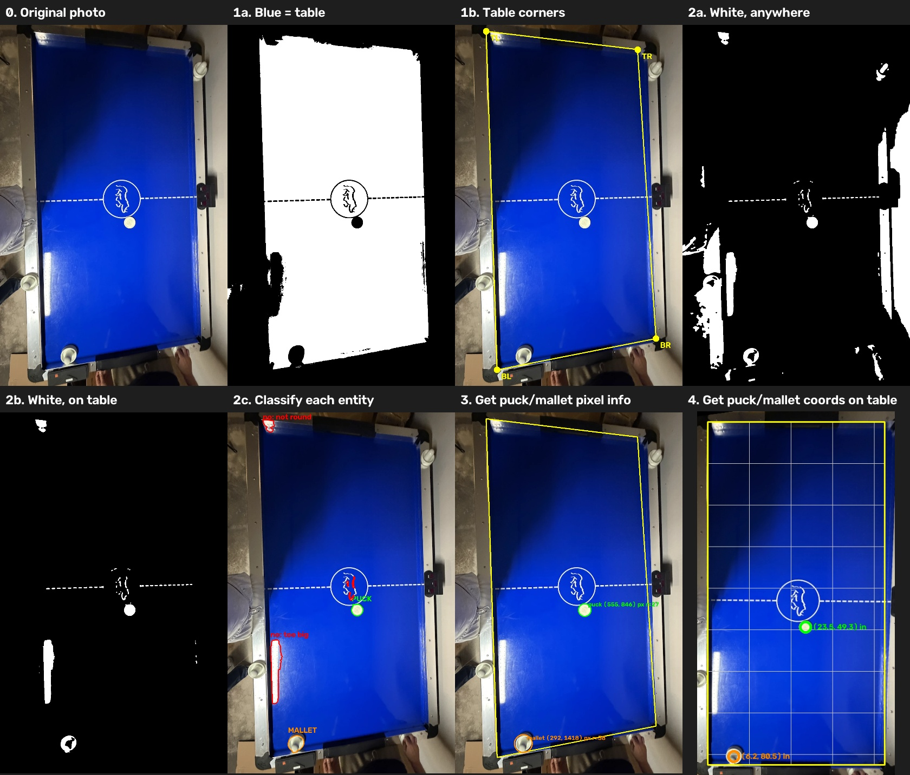

# Vision

First-stage image processing: take an overhead photo of the table and find **where the puck and
mallets are, in inches on the table**. Single photos for now; the live camera comes later.



## Pipeline

```
photo ──► 1. Calibration ──────────► table outline + pixel→inch converter
            (table_calibration.py)          │
                                            ▼
          2. Puck & mallet detection ─► puck, mallets (pixels)
            (puck_mallet_detector.py)       │
                                            ▼
          3. Convert + check ─────────► positions in inches + "what's missing"
            (pipeline.py)
```

### 1. Calibration — where is the table?
Finds the blue playing surface and its 4 corners. Knowing their real size
(50 × 90 in table − 3.75 in rails = 42.5 × 82.5 in), it builds a matrix (a *homography*)
that converts any pixel to a table position in inches.

### 2. Puck & mallet detection — what's on it?
Finds every white shape on the table, measures its size, roundness and fill, and sorts it:
- **puck**: small, round, solid
- **mallet**: bigger, round
- **rejected**: lines, logo, glare (with the reason)

## Files

**The pipeline**

| File | Does | Use it |
| --- | --- | --- |
| `table_calibration.py` | **Step 1.** Blue surface → 4 corners → pixel↔inch converter | `TableCalibration.from_photo(image, settings.table)` → `.to_table(u, v)` |
| `puck_mallet_detector.py` | **Step 2.** White shapes on the table → puck / mallet / rejected (+ why). Pixels only. | `PuckMalletDetector(settings.detector).find(image, table_outline)` → `.puck`, `.mallets` |
| `pipeline.py` | Runs 1 → 2, converts to inches, flags problems | `analyze(image, settings)` → `.puck.position_in`, `.problems` |

**Around it**

| File | Does |
| --- | --- |
| `configs/our_table.json` | Values to tune: table size, colour ranges, puck/mallet size rules |
| `settings.py` | What each value means; loading catches typos |
| `cli.py` | `puckbot-analyze`: prints the report, saves pictures |
| `drawing.py` | Marked-up photo, top-down view, the step grid above |
| `tests/` | Each step on made-up photos + full run on the sample photo |
| `data/` | `samples/` reference photo; `steps.jpg` from `--steps` |

## Run

From the repo root, with the environment active (`source .venv/bin/activate`).

**Analyse a photo:** where the table, puck and mallets are

```bash
puckbot-analyze photo.png
```
```
  table   : found, playing surface 42.5 x 82.5 in
  puck    : pixel (555, 846) -> x=23.5 in, y=49.3 in, ~3.6 in across
  mallet 1: pixel (292, 1418) -> x=6.2 in, y=80.5 in, ~4.3 in across
  all good                       <- or a list of what's missing + how to fix it
```
Add `--out result.png` to also save the marked-up photo + top-down view.

**See every step:** for debugging or tuning settings

```bash
puckbot-analyze photo.png --steps steps.png
```
Saves one grid picture like the one at the top of this page.

**From Python**

```python
import cv2
from puckbot.vision import analyze, load_settings

result = analyze(cv2.imread("photo.png"), load_settings())
result.puck.position_in      # (x, y) inches on the table
result.mallets               # list, each with .position_in
result.problems              # [] if all good
```

**Tests**

```bash
pytest
```

## Known gaps

- Table size is calculated, not measured. Positions are off by ~1–2 in. Measure inside the rails.
- Photo is taken at an angle; a camera straight overhead will be more accurate.
- Puck/mallet sizes in the settings are in pixels, so they change if the camera moves.
